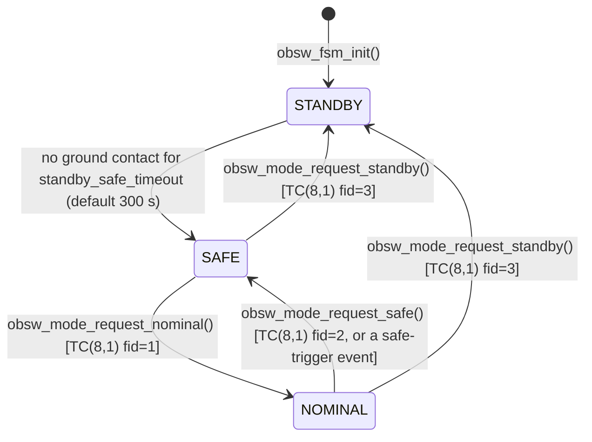
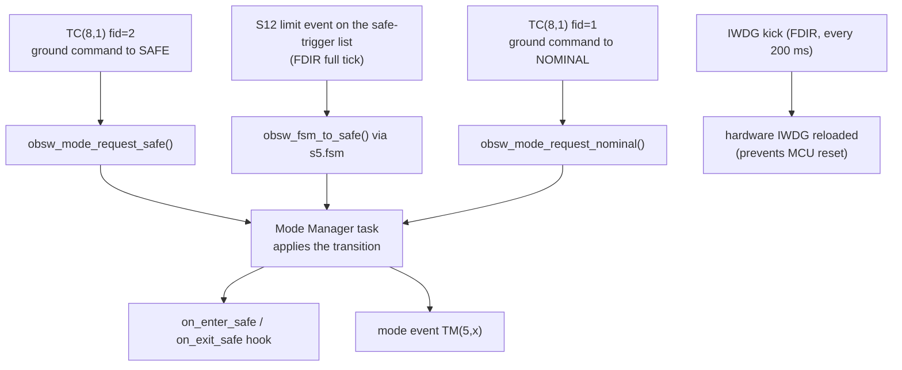

# Architecture

## Overview

OpenOBSW is a C11 on-board software stack built on CCSDS space packets and
ECSS PUS-C services. It has no dynamic allocation, no global state in the
core library, and a HAL boundary between the protocol stack and platform I/O.

It is the reference OBSW for [OpenSVF](https://opensvf.readthedocs.io/),
which validates it closed loop against equipment and dynamics models.

What each target builds in is on the [Targets](targets.md) page; the bytes on
the wire are on the [Wire protocol](icd.md) page.

---

## Design principles

**Zero dynamic allocation.** All state is caller-owned. No `malloc`, no heap
use anywhere inside the library. Routing tables, ring buffers and dispatcher
contexts are statically allocated by the application and passed in at init.
CI checks the built library for allocator symbols (OBSW-SRS-001).

**No global state.** Every function takes an explicit context pointer.
Multiple dispatcher instances can coexist; there is no shared mutable state
between them. CI checks the built library for writable data symbols
(OBSW-SRS-002).

**Portable C11.** No POSIX dependencies in the core library. It compiles
under `-Wall -Wextra -Wpedantic` with zero warnings, and CI builds with
`-Werror`.

**HAL-isolated.** The core stack never calls platform I/O directly. All I/O
goes through `obsw_io_ops_t`, a vtable of function pointers. Platform ports
implement it once; the rest of the stack is untouched.

**Validation-first.** Every module has a unit test suite, an integration test
runs the uplink and downlink path end to end, and system tests drive the host
simulator over the wire protocol.

---

## Layer model

Every target feeds whole TC space packets to the dispatcher and sends whole
TM space packets. The CCSDS transfer frame layers (`ccsds/tc_frame`,
`ccsds/tm_frame`) are library code with unit tests; no target uses them yet.

```
 Raw bytes from the UART, pipe or socket
        │  target main loop: wire protocol framing (sim/, src/task/tmtc.c, src/platform/*)
        ▼
 Space Packet layer   ccsds/space_packet.h   primary header decode, zero-copy
        ▼
 TC Dispatcher        tc/dispatcher.h        gate (mode whitelist), then route on APID/service/subservice
        ▼
 PUS-C services       pus/s1 s3 s5 s6 s8 s9 s11 s12 s17 s19 s20
        │
        ├── mode requests ──▶ Mode Manager / FSM   fdir/fsm.h, task/mode.h
        └── TM packets   ──▶ TM store             tm/store.h ──▶ target main loop ──▶ HAL write
```

The FreeRTOS image on STM32H7 splits this across tasks; see
[FreeRTOS](freertos-architecture.md).

---

## Module reference

### `ccsds/space_packet`: CCSDS 133.0-B

The unit of the stack: every TC and TM is a space packet.

Key types: `obsw_sp_primary_hdr_t`, `obsw_sp_packet_t`

Key functions:

- `obsw_sp_encode_primary()`: serialise the primary header to 6 bytes
- `obsw_sp_decode_primary()`: deserialise 6 bytes into the header struct
- `obsw_sp_parse()`: decode the header and set the payload pointer (zero-copy)

### `ccsds/tc_frame`: CCSDS 232.0-B (library only)

Decodes TC transfer frames and validates the CRC-16/CCITT FECF before
exposing the data field. No target calls it yet.

Key types: `obsw_tc_frame_header_t`, `obsw_tc_frame_t`

Key functions:

- `obsw_tc_frame_decode()`: parse the header, validate the CRC, set the data pointer
- `obsw_crc16_ccitt()`: poly 0x1021, init 0xFFFF; the one CRC implementation,
  also used by S6 memory check and the TM frame builder

Primary header fields decoded:

| Field | Bits | Notes |
|---|---|---|
| version | 2 | Always 0b00 |
| bypass_flag | 1 | Type-A/B service |
| ctrl_cmd_flag | 1 | Control command |
| spacecraft_id | 10 | SCID, assigned per spacecraft; must match the TM frame builder. See [Mission configuration](mission-config.md) |
| virtual_channel_id | 6 | VCID |
| frame_len | 10 | Total frame octets minus 1 |
| frame_seq_num | 8 | Wraps at 255 |

### `ccsds/tm_frame`: CCSDS 132.0-B (library only)

Builds TM transfer frames: packs TM space packets into the data field, fills
unused space with idle packets (CCSDS 133.0-B §4.3) and optionally appends the
CRC-16/CCITT FECF. No target calls it yet.

Key types: `obsw_tm_frame_config_t`; key function: `obsw_tm_frame_build()`.

```c
obsw_tm_frame_config_t cfg = {
    .spacecraft_id               = 0x001,
    .virtual_channel_id          = 0,
    .master_channel_frame_count  = 0,   /* incremented by caller each frame */
    .virtual_channel_frame_count = 0,
    .enable_fecf                 = 1,
    .frame_data_field_len        = 64,  /* mission-specific */
};
```

### `pus/s6`: memory management

Ground-commanded memory load, check and dump. Addresses are 4-byte
big-endian fields.

Key handlers: `obsw_s6_load()`, `obsw_s6_check()`, `obsw_s6_dump()`

| Subservice | TC | TM response |
|---|---|---|
| 2 | Load memory area | TM(1,1) + TM(1,7) |
| 5 | Check memory area (CRC-16/CCITT) | TM(6,10) match / TM(6,11) mismatch |
| 9 | Dump memory area | TM(6,6) data packet |

Accesses outside the region table, or without the region's READ/WRITE
right, are rejected (fails closed).

### `pus/s8`: function management

Runs on-board functions by ID from a static, caller-owned table.

Key handler: `obsw_s8_perform()`

| Function ID | Constant | Effect |
|---|---|---|
| 1 | `OBSW_S8_FN_RECOVER_NOMINAL` | Request SAFE to NOMINAL |
| 2 | `OBSW_S8_FN_REQUEST_SAFE` | Request any mode to SAFE |
| 3 | `OBSW_S8_FN_REQUEST_STANDBY` | Request any mode to STANDBY |

On FreeRTOS the handlers call `obsw_mode_request_*()` and do not touch the
FSM; the Mode Manager task owns it. Additional function IDs are registered
by the application in `obsw_s8_entry_t[]`.

### `tc/dispatcher`: routing and gate

Routes TC space packets to registered handlers through a static table. First
match wins. APID `0xFFFF` is a wildcard that matches any APID; every target
uses it, so a target accepts a TC on any APID (the SRDB addresses all TCs to
`0x010`).

```c
static obsw_tc_route_t routes[] = {
    { .apid = 0xFFFF, .service = 17, .subservice = 1,
      .handler = handle_s17_ping, .ctx = NULL },
    { .apid = 0xFFFF, .service =  3, .subservice = 5,
      .handler = handle_s3_enable_hk, .ctx = &hk_ctx },
};

obsw_tc_dispatcher_init(&dispatcher, routes,
                         sizeof(routes)/sizeof(routes[0]),
                         my_responder, NULL);
```

Handlers receive a parsed `obsw_tc_t` and a `responder` callback:

```c
int handle_s17_ping(const obsw_tc_t *tc,
                     obsw_tc_responder_t respond,
                     void *ctx)
{
    respond(OBSW_TC_ACK_ACCEPT | OBSW_TC_ACK_COMPLETE, tc, ctx);
    return 0;
}
```

An optional gate (`obsw_tc_dispatcher_set_gate()`) is asked first. Every
target with a mode machine installs `obsw_fsm_tc_gate` there; the STM32H7
superloop has none. A TC refused by the gate, or matching no route, is passed
to the responder with `OBSW_TC_ACK_REJECT` and a reason
(`OBSW_TC_REJECT_GATED`, `_SVC` or `_SUBSVC`). Targets use
`obsw_s1_dispatch_responder`, which reports it as TM(1,2) with code `0x0007`,
`0x0002` or `0x0003`. The gate runs before route lookup, so in SAFE an
unknown TC is reported as mode-gated.

### `tm/store`: TM ring buffer

Fixed-size power-of-two ring buffer for outgoing TM packets. PUS services
enqueue; the target main loop (or the FreeRTOS TMTC task) dequeues and sends.
Sized at compile time with `OBSW_TM_STORE_SLOTS` (default 32) and
`OBSW_TM_MAX_PACKET_LEN` (default 1024 bytes). It is not safe for concurrent
writers; see [Known limits](known-limits.md#stm32h7-freertos).

### `hal/io`: platform I/O vtable

```c
typedef struct {
    int (*write)(const uint8_t *buf, uint16_t len, void *ctx);
    int (*read)(uint8_t *buf, uint16_t len, void *ctx);
    void *ctx;
} obsw_io_ops_t;
```

Lengths are `uint16_t`, not `size_t`, for 16-bit targets such as the MSP430.

| Platform | Implementation |
|---|---|
| Host sim | stdin / stdout |
| STM32H7 | USART3 (`src/hal/stm32h7/uart.c`) |
| ZynqMP | Cadence UART (`src/hal/zynqmp/uart.c`) |
| MSP430 | eUSCI_A0 UART (`src/hal/msp430/uart.c`) |

Under Renode the same UART drivers run against the emulated UART, which
Renode exposes as a TCP socket.

---

## Mode Manager and FDIR

### Three-state FSM: `fdir/fsm.h` and `task/mode.h`

The mode FSM has three states. All state is caller-owned. On FreeRTOS the
Mode Manager task (`task/mode.h`) is the only owner of the FSM instance.



**STANDBY** is the boot state. AOCS is off; only whitelisted TCs are
accepted, as in SAFE. LEOP autonomy (`fdir/standby_timer.h`,
OBSW-SRS-187..189): if no ground contact arrives within
`standby_safe_timeout` seconds (SRDB `0x0008`, default 300, `0` = at once)
the Mode Manager commands SAFE, so detumbling starts even when the first pass
is missed. Any well-formed TC, accepted or rejected, restarts the countdown.
On the STM32H7 the value is an S20 parameter read every second (TC(20,1)
applies immediately, from SAFE or NOMINAL, since STANDBY only allows
TC(20,3)); its initial value is the build option
`OBSW_STANDBY_SAFE_TIMEOUT_S`, for example `-DOBSW_STANDBY_SAFE_TIMEOUT_S=30`
for a bench demo. The host sim starts in SAFE and skips STANDBY.

**SAFE** is the fault-containment mode. Only B-dot runs (magnetometer and
magnetorquers). Only whitelisted TCs are accepted.

**NOMINAL** is the full-operations mode. PD quaternion control runs with the
star tracker, gyro and reaction wheels.

**Entry and exit hooks** are mission-defined function pointers in
`obsw_fsm_config_t`, for example a safe beacon on entry to SAFE. Neither
hook is mandatory.

**TC whitelist.** In SAFE and STANDBY every other TC is rejected with TM(1,2)
code `0x0007`. The gate (`obsw_fsm_tc_gate`, then `obsw_fsm_tc_allowed()`)
runs before routing. The whitelist is `SRDB_SAFE_TC_WHITELIST`, generated
from `safe_allowed: true` in `srdb/data/telecommands.yaml`; see the
[Telecommands](srdb/telecommands.md) page.

**Mode Manager API** (`include/obsw/task/mode.h`, FreeRTOS):

```c
void obsw_mode_task_init(obsw_tm_store_t *tm_store);
obsw_fsm_ctx_t *obsw_mode_get_fsm(void);
void obsw_mode_request_nominal(void);   /* called by S8 fid=1 handler */
void obsw_mode_request_safe(void);      /* called by S8 fid=2 handler */
void obsw_mode_request_standby(void);   /* called by S8 fid=3 handler */
```

Requests are `volatile bool` flags that the Mode Manager polls every second.
Since #128 it applies them inside a critical section and reads the mode
inside it, because FDIR (higher priority) can command SAFE directly through
S12 monitoring.

### FDIR task: `task/fdir.h` (FreeRTOS)

FDIR is a fault responder. It does not own the FSM; it reaches the Mode
Manager's FSM through the S5 context when an event on the safe-trigger list
is raised.

- **200 ms sub-tick:** kicks the hardware IWDG.
- **1 s full tick:** advances on-board time, runs the S12 limit checks
  (`obsw_pus_s12_check()`, which raises the limit events and, for events on
  the safe-trigger list, commands SAFE), ticks S3 housekeeping and redraws
  the LCD dashboard.

API: `obsw_fdir_task_init()`, `obsw_fdir_get_s3_ctx()` (the PUS task routes
TC(3,x) to this context) and `obsw_fdir_set_reset_cause()` (reset cause for
the dashboard).

### Watchdog: `fdir/watchdog.h`

Software countdown watchdog, with no dependency on OS timers.

```
Control cycle:
  obsw_wd_kick(&wd)    called by the monitored task
  obsw_wd_tick(&wd)    called once per cycle after all kicks

  If kicked:  countdown reloaded to timeout_ticks
  If not:     countdown decrements
  At zero:    expire_cb() fired once (latched, no repeat)
```

Typical wiring to the FSM:

```c
static void on_wd_expiry(void *ctx)
{
    obsw_s5_report(&s5, OBSW_S5_HIGH, EVENT_WD_EXPIRY, NULL, 0);
    obsw_fsm_to_safe((obsw_fsm_ctx_t *)ctx);
}

obsw_wd_init(&wd, 10, on_wd_expiry, &fsm);
```

The host sim kicks the watchdog every tick and never ticks it down, so it
cannot raise `watchdog_expiry`; the MSP430 loop ticks it.

### S5 safe-trigger coupling

`obsw_s5_ctx_t` carries an optional FSM pointer and a static list of
`safe_trigger_ids`. If an `OBSW_S5_HIGH` report is emitted with a matching
event ID, `obsw_fsm_to_safe()` is called:

```c
static const uint16_t ids[] = SRDB_SAFE_TRIGGER_IDS;   /* generated from events.yaml */
s5.fsm = (struct obsw_fsm_ctx *)&fsm;
(void)obsw_s5_set_safe_triggers(&s5, ids, SRDB_SAFE_TRIGGER_COUNT);
```

The host sim, the MSP430 target and the FreeRTOS tasks load the generated
list this way, so the events that command SAFE are the SRDB's
`safe_trigger: true` events (see [Events](srdb/events.md)). Each site has a
`_Static_assert` that the list fits `OBSW_S5_MAX_SAFE_TRIGGERS`; the MSP430
build sets it to 4, exactly the current SRDB count.

With `fsm` NULL, S5 only reports.

### Event auxiliary data

TM(5,x) application data is the event ID (2 bytes) followed by the event's
auxiliary data, declared per event in `srdb/data/events.yaml`. The limit
events (`power_fault_3v3`, `power_fault_5v`, `temperature_soft_limit`,
`temperature_hard_limit`) are raised by S12 monitoring, and S12 always sends
the monitored value as one big-endian IEEE 754 float32, whatever the
parameter's own type: `obc_temperature` raw 1300 arrives as `1300.0`. Their
SRDB entries declare `value: float32` accordingly. The generated header
carries `SRDB_EVENT_<NAME>_AUX_LEN`, and the host sim and the FreeRTOS PUS
task fail to compile if one of these differs from `OBSW_S12_EVENT_AUX_LEN`.
An event ID bound through TC(12,3) that the SRDB defines with another layout
is still sent with the float32 value.

### FDIR event flow (FreeRTOS)



### Trap table stubs

Platform fault handlers are in `src/hal/arm/`. They are declared
`__attribute__((weak))`; the application overrides them with strong
definitions.

Each handler must:

1. Emit an `OBSW_S5_HIGH` event (if an S5 context is available).
2. Call `obsw_fsm_to_safe()`.
3. Halt (`while(1)`) or trigger a hardware reset, as mission policy says.

| Platform | File | Handlers |
|---|---|---|
| ARM Cortex-A (ZynqMP) | `src/hal/arm/trap_table_arm.c` | Undefined instruction, data abort, prefetch abort, stack overflow |
| MSP430 | `src/hal/arm/trap_table_msp430.c` | WDT expiry, vacant vector, system NMI |

---

## AOCS

The active control law follows the FSM mode. The host sim (`sim/main.c`),
the ZynqMP loop and the FreeRTOS AOCS task gate it the same way.

| FSM mode | Control law | Sensors | Actuators |
|---|---|---|---|
| STANDBY | off, zero output | | |
| SAFE | B-dot (`aocs/bdot.c`) | Magnetometer | Magnetorquers |
| NOMINAL | PD quaternion (`aocs/adcs.c`) | Star tracker and gyro | Reaction wheels |

```c
obsw_fsm_mode_t mode = obsw_fsm_mode(&fsm_ctx);

if (mode == OBSW_FSM_NOMINAL && sensor.st_valid && sensor.gyro_valid)
    /* PD control: reaction wheel torques */
else if (mode == OBSW_FSM_SAFE && sensor.mag_valid)
    /* B-dot: magnetorquer dipoles */
/* else: STANDBY or no valid sensors: zero actuator output */
```

On the STM32H7 FreeRTOS image the AOCS task reads the QMC5883L
magnetometer, not sensor frames; it has no star tracker or gyro, so NOMINAL
never runs PD control there.

### B-dot controller: `aocs/bdot.h`

Detumbling law, magnetometer only:

```
m_cmd = -k * dB/dt
```

`dB/dt` is the finite difference of successive magnetometer readings, passed
through a first-order washout high-pass filter that rejects the slow,
orbit-induced change of the field (#70):

```
y[k] = a * (y[k-1] + x[k] - x[k-1]),   a = tau / (tau + dt)
```

`tau` is SRDB parameter `bdot_hpf_tau` (`0x20A3`, default 15 s, `0`
disables the filter). The first step outputs zero (no prior sample), dipole
commands are saturated at `config.max_dipole`, and `obsw_bdot_reset()`
clears the state on mode re-entry. `obsw_bdot_step()` also returns the raw
and the filtered dB/dt for diagnostics.

```c
obsw_bdot_config_t cfg = { .gain = 1.0e4f, .max_dipole = 10.0f, .hpf_tau = 15.0f };
obsw_bdot_init(&ctx, &cfg);
obsw_bdot_step(&ctx, b_body, dt, &out);   /* out.m_cmd [A m^2] */
```

### PD attitude controller: `aocs/adcs.h`

Quaternion-error PD controller:

```
q_err = q_cmd ⊗ q_meas*            (multiplicative error)
tau_cmd = -Kp * q_err_vec - Kd * w (PD law)
```

`q_err_vec` is the vector part of the error quaternion and `w` the gyro
angular rate. The sign of `q_err` is flipped when its scalar part is negative
(short path), torque is saturated at `config.max_torque`, and the step
returns `false` if the measured quaternion has near-zero norm.

### S20-tunable gains

| SRDB parameter | ID | Default | Unit | Controller |
|---|---|---|---|---|
| `bdot_gain` | 0x20A0 | 1.0e4 | A m^2 s/T | B-dot |
| `adcs_kp` | 0x20A1 | 0.5 | N m/rad | PD |
| `adcs_kd` | 0x20A2 | 0.1 | N m s/rad | PD |
| `bdot_hpf_tau` | 0x20A3 | 15 | s | B-dot filter |

Ground updates them with TC(20,1). The host sim reads them from its S20 table
before every control step; the FreeRTOS AOCS task reads them with
`obsw_pus_s20_get_float()`. HK set 4 (`aocs_hk`) reports the gains; see
[Housekeeping sets](srdb/hk-sets.md).

Do not retune `bdot_gain` until the filter is validated on the opensvf-kde
orbital environment ([Known limits](known-limits.md#aocs)).

---

## B-dot convergence harness: `sim/bdot_harness.py`

A closed-loop convergence test of the SAFE-mode control path that needs no
Renode. It drives `obsw_sim` as a subprocess over the wire protocol.

**Physics model:**

- Circular SSO orbit at 550 km, inclination 97.4°
- Geocentric dipole field: `B = (B0 Re^3 / r^3)(3 (m̂·r̂) r̂ - m̂)`, m̂ = -ẑ
- Rigid-body dynamics: `I ω̇ = τ - ω × (I ω)`
- Quaternion kinematics: `q̇ = ½ q ⊗ [0, ω]`, first-order integration

**Convergence criterion:** |ω| < 0.05 rad/s within 3 orbital periods.

**Result on `main` at `6b45b46` (2026-11-23):** detumbles from |ω| = 0.866
rad/s in 2774.6 s (0.48 orbital periods), with the default `bdot_hpf_tau`.

```bash
source scripts/activate.sh
python3 sim/bdot_harness.py               # default: 550 km SSO, ω0 = [0.5, 0.5, 0.5] rad/s
python3 sim/bdot_harness.py --max-periods 5 --omega0 1 1 1   # higher tumble
```

---

## OpenSVF boundary

OpenOBSW owns the control laws, the PUS interface and the mode machine.
[OpenSVF](https://opensvf.readthedocs.io/) (Python) runs the validation
campaigns and the equipment models; opensvf-kde (C++, FMI 2.0, not public
yet) is the dynamics engine it can use. They meet at the
[wire protocol](icd.md): OpenSVF sends a sensor frame each tick and reads
back the actuator frame and TM.

---

## Standards references

| Standard | Title |
|---|---|
| CCSDS 133.0-B | Space Packet Protocol |
| CCSDS 232.0-B | TC Space Data Link Protocol |
| CCSDS 132.0-B | TM Space Data Link Protocol |
| CCSDS 131.0-B | TM Synchronization and Channel Coding |
| ECSS-E-ST-70-41C | Packet Utilisation Standard (PUS-C) |

---

## MSP430FR5969 target

The smallest target: it shows that the stack fits 2 KB of SRAM. It builds in
CI on every PR and has been bench-tested once on a LaunchPad (TC/TM ping).
The dual-OBC role once planned for it is parked (#29 to #31).

| Resource | Value |
|---|---|
| Architecture | 16-bit RISC, MSP430 |
| SRAM | 2 KB (0x2000 to 0x27FF) |
| FRAM | 47 KB (0x4400 to 0xFF7F) |
| Toolchain | TI msp430-elf-gcc 9.3.1.11 |

### Build profile

The MSP430 build overrides the default sizes to fit 2 KB of SRAM
(`targets/msp430-fr5969/CMakeLists.txt`):

| Parameter | Default | MSP430 profile |
|---|---|---|
| `OBSW_TM_STORE_SLOTS` | 32 | 4 |
| `OBSW_TM_MAX_PACKET_LEN` | 1024 B | 64 B |
| `OBSW_TC_FRAME_MAX_LEN` | 1024 B | 128 B |
| `OBSW_S5_MAX_SAFE_TRIGGERS` | 8 | 4 |

TM store total: 4 × 64 = 256 bytes.

### UART

`src/hal/msp430/uart.c` implements `obsw_io_ops_t` on eUSCI_A0 (P2.0/P2.1),
the LaunchPad backchannel UART, at 9600 baud. The MSP430 uses its own
length-prefixed framing, not wire protocol v4; see
[MSP430 framing](icd.md#msp430-framing).

### Build outputs and cross-compilation

```
build-msp430/
  openobsw-msp430.elf   ELF image for Renode and GDB
  openobsw-msp430.hex   Intel HEX for mspdebug / UniFlash / MSPFlasher
  openobsw-msp430.map   linker map
```

```bash
cmake -B build-msp430 \
  -DCMAKE_TOOLCHAIN_FILE=$(pwd)/cmake/msp430-toolchain.cmake \
  -DCMAKE_EXPORT_COMPILE_COMMANDS=ON \
  -S targets/msp430-fr5969
cmake --build build-msp430
```

See [MSP430 build](msp430-build.md) for the toolchain. The build writes
`build-msp430/compile_commands.json`; `.vscode/c_cpp_properties.json` uses it
for IntelliSense.

---

## STM32H750VBT6 target

The WeAct STM32H750 board, Cortex-M7. Two images build from
`targets/stm32h7`:

- **FreeRTOS** (`-DOBSW_FREERTOS=ON`): the full image, five tasks, LCD
  dashboard, QMC5883L magnetometer. See [FreeRTOS](freertos-architecture.md).
- **Superloop** (default, `OBSW_FREERTOS` OFF): a Renode smoke-test build
  that routes TC(17,1), TC(20,1) and TC(20,3) only and runs no AOCS.

Neither image is a closed-loop SIL target yet (#54).

| Resource | Value |
|---|---|
| Architecture | ARM Cortex-M7, FPU |
| SYSCLK | 64 MHz HSI (reset default; the 480 MHz PLL setup is disabled, #72) |
| Flash | 128 KB @ 0x08000000 |
| RAM | 512 KB AXI SRAM @ 0x20000000 |
| Toolchain | arm-none-eabi-gcc 13.2 |

`system_clock_init()` only sets the flash latency for 64 MHz; it is compiled
out with `OBSW_RENODE=ON`.

### UART

`src/hal/stm32h7/uart.c` implements `obsw_io_ops_t` on USART3, PD8 (TX) and
PD9 (RX), 115200 baud. BRR = 64 000 000 / 115 200 = 556.

### Build

```bash
# FreeRTOS image for the board (alias: stm32h7-build)
cmake -S targets/stm32h7 -B build_stm32h7 \
    -DCMAKE_BUILD_TYPE=Debug \
    -DCMAKE_TOOLCHAIN_FILE=$(pwd)/cmake/stm32h7-toolchain.cmake \
    -DOBSW_ROOT=$(pwd) -DOBSW_FREERTOS=ON
cmake --build build_stm32h7 -j$(nproc)

# Renode image: a separate build directory, which stm32h750_obsw.resc loads.
# Add -DOBSW_FREERTOS=ON for the FreeRTOS image, leave it out for the superloop.
cmake -S targets/stm32h7 -B build_stm32h7_renode \
    -DCMAKE_BUILD_TYPE=Debug \
    -DCMAKE_TOOLCHAIN_FILE=$(pwd)/cmake/stm32h7-toolchain.cmake \
    -DOBSW_ROOT=$(pwd) -DOBSW_RENODE=ON -DOBSW_FREERTOS=ON
cmake --build build_stm32h7_renode -j$(nproc)
```

Outputs: `obsw_stm32h7.elf` (GDB, OpenOCD, Renode) and `obsw_stm32h7.bin`
(OpenOCD `program`).

### Flashing

```bash
# OpenOCD + ST-Link V2 (from WSL2 if USB is not passed through to the container)
openocd -f interface/stlink.cfg -f target/stm32h7x.cfg \
    -c "program /absolute/path/to/build_stm32h7/obsw_stm32h7.bin 0x08000000 verify reset exit"
```

The tilde (`~`) is not expanded inside the OpenOCD `-c` string: use the
absolute path. The `stm32h7-flash` alias in `scripts/activate.sh` does this.

### Renode emulation

```bash
renode renode/stm32h750_obsw.resc   # alias: renode-stm32h7
python3 renode/test_ping_stm32h7.py # alias: renode-ping-stm32h7
```

The platform model (`renode/stm32h750.repl`) wires USART3 to a TCP socket
terminal on port 3456. RCC and GPIOD are stub memories that absorb the
register writes of `obsw_uart_init()`. Renode runs this board at about 0.4
times real time; the other Renode tests and what each shows are on the
[Targets](targets.md) page.
